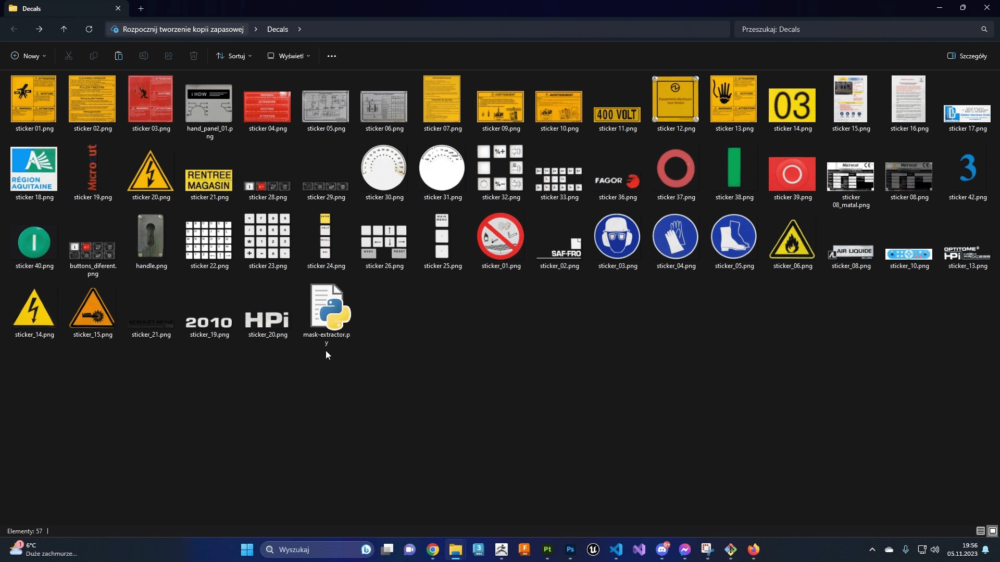

# Mask-extractor

A Python/Pillow tool that extracts the alpha (transparency) channel from PNG files and saves each one as a separate mask image. It saved a ton of time while texturing.



**Features**

- Processes every `.png` file in the current directory in one run
- Saves masks to a `masks/` folder, created automatically
- Names output files `<original_name>_mask.png`

**Requirements**

- Python 3.6+
- Pillow

```bash
pip install Pillow
```

**Usage**

1. Place the script in the folder with your PNG files.
2. Run it:

```bash
python mask_extractor.py
```

3. Collect your masks from the `masks/` folder.

**Notes**

- Only the top level of the current folder is scanned, not subfolders.
- Images without transparency produce solid white masks.

## License

This project is licensed under the MIT License. See the [LICENSE](LICENSE) file for details.